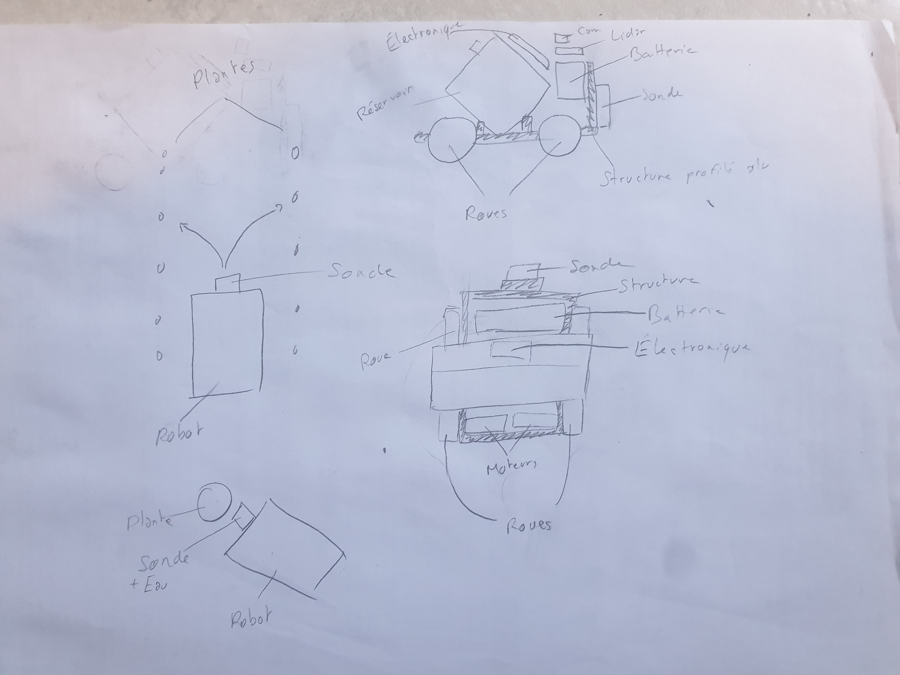

Nous avons reçu une partie du matériel commandé.
Nous avons mesuré chaque composant et les avons modélisés en 3D sur Fusion 360.

À partir de ces composants, nous avons étudié plusieurs dispositions possibles sur le robot afin de retenir la plus adaptée. Nous avons pris en compte les critères suivants :

Arrosage : possibilité d’arroser les plantes des deux côtés du robot, sans rouler dessus
Capteurs : sonde, caméra et lidar dégagés
Centre de masse : éviter que la sonde ne soulève le robot ou que celui-ci ne bascule
Compacité
Rigidité
Accessibilité pour la maintenance
Facilité d’assemblage
Esthétique

Après plusieurs essais, nous avons retenu la disposition suivante :

La prochaine étape consistera à assembler les pièces sur la modélisation 3D et à commencer la partie électronique et informatique dès réception du matériel restant.
