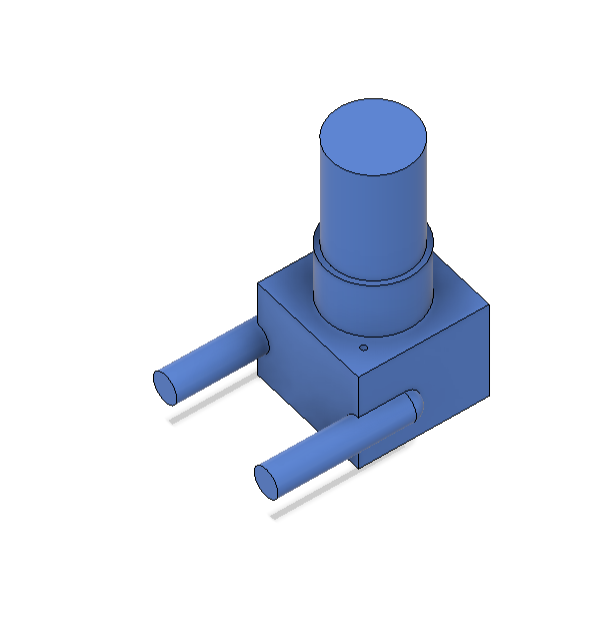
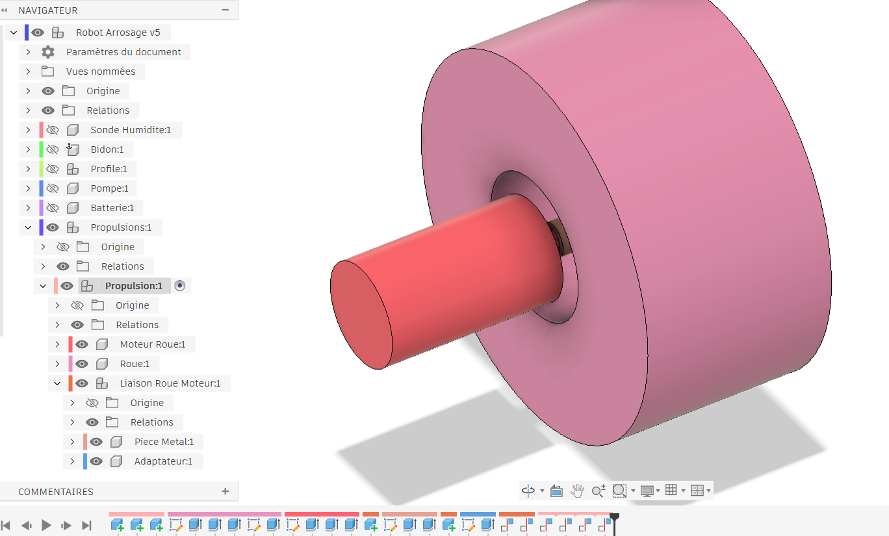
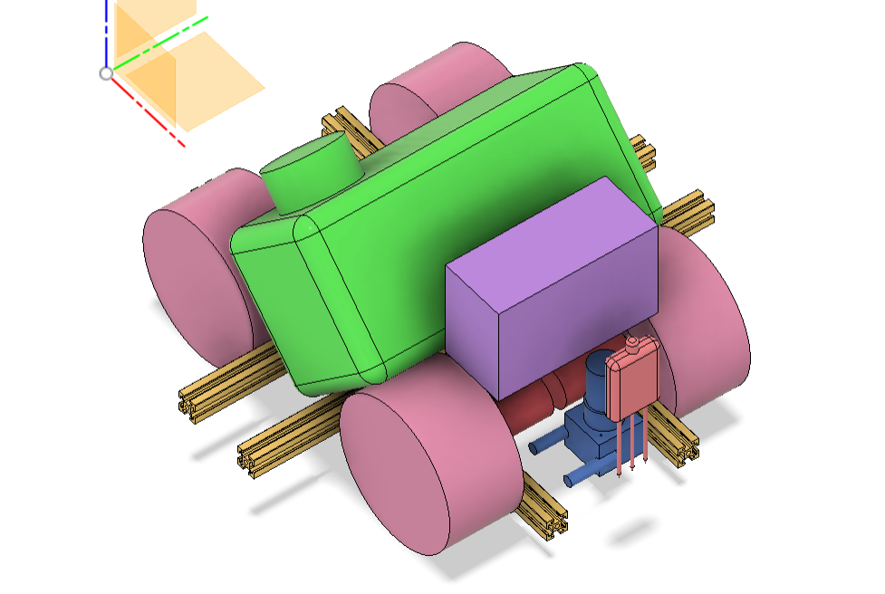

## Compte rendu de séance

Lors de cette séance, nous nous sommes réparti la modélisation des nouveaux composants reçus ainsi que leur assemblage, en vue de découper les rails de profilé en aluminium et d'imprimer les premières pièces.

### Pompe

J'ai modélisé la pompe en dessinant les trous qui nous permettront de la visser sur un adaptateur en plastique, qu'il reste à concevoir. Dans la réalité, il faudra percer une partie en plastique de la pompe pour accéder à un filetage condamné par le fabricant en dessous.

### Propulsion

Je me suis ensuite occupé de la partie propulsion du robot : les moteurs, les roues et, surtout, les éléments qui les relient et assurent une bonne transmission de la rotation. Nous avions un adaptateur métallique en stock, que j'ai modélisé. S'il s'emboîte parfaitement sur la roue, il n'est en revanche pas adapté à l'arbre du moteur. J'ai donc conçu un petit adaptateur à imprimer pour combler cet écart.

### Assemblage du robot

Après avoir dessiné la batterie, j'ai assemblé et contraint les différents composants dans la modélisation, afin d'avoir une meilleure idée des dimensions réelles du robot.

### Changement de lidar

Le lidar 2D prévu initialement ayant été récupéré par quelqu'un d'autre, j'ai commandé un nouveau lidar. J'en ai profité pour passer à un lidar 3D, qui fournit 64 points sur un champ de 65°. Il est mieux adapté à notre usage : le lidar 2D aurait produit davantage de données, plus difficiles à traiter et en grande partie inutiles, puisqu'une partie d'entre elles auraient concerné l'arrière du robot. Le lidar 3D ne voit que devant, ce qui correspond à notre besoin, et nous donne plus d'informations sur la zone qui nous intéresse.
