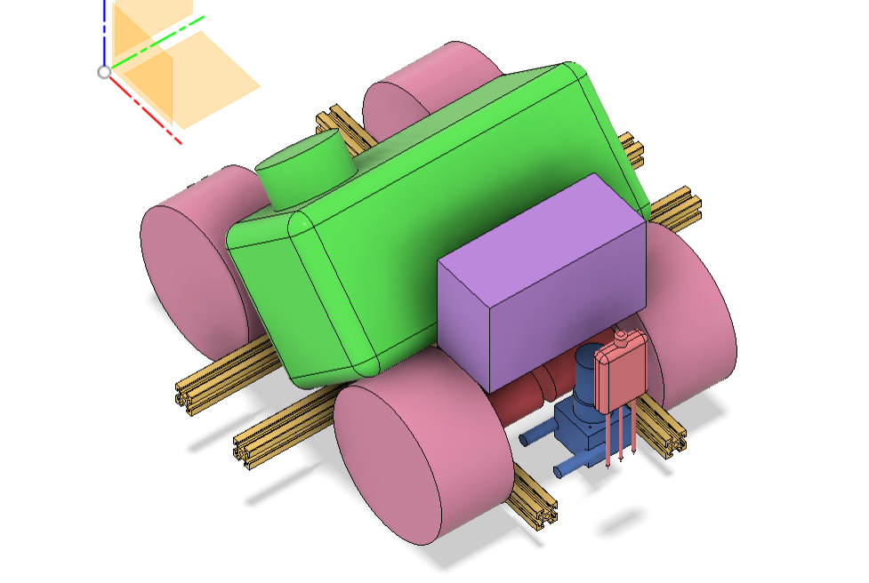

## Compte rendu de séance

### Conception de la plaque électronique

Lors de cette séance, j'ai avancé sur la modélisation de la section électronique, qui doit permettre de fixer et d'accéder facilement aux Raspberry, ESP32, batterie, etc. J'ai décidé de créer une plateforme découpée au laser dans du contreplaqué : elle permet de visser l'électronique avec un écrou de l'autre côté. C'est plus adapté qu'un support imprimé en plastique, long à imprimer et à réimprimer entièrement si les trous ne sont pas au bon endroit. Le contreplaqué est donc plus rapide pour ce cas, où l'on a besoin d'une surface plane. Cette plaque sera maintenue par le profilé et surélevée pour laisser la place de loger la pompe en dessous.

### Coque de l'ESP32

J'ai imprimé une coque d'ESP32 trouvée sur Thingiverse, à laquelle j'ai ajouté des trous pour pouvoir la fixer à la plaque. Elle est réalisée en PETG, qui est moins inflammable que le PLA et résiste mieux à la chaleur.

[Modèle original sur Thingiverse](https://www.thingiverse.com/thing:4722725)

### Emplacement du LiDAR 3D et de la caméra

Nous avons réfléchi à l'emplacement du LiDAR 3D et de la caméra. Nous avions prévu de les placer l'un au-dessus de l'autre au centre avant, mais cela aurait ajouté une hauteur inutile au robot : la sonde occupe déjà le centre avant et son système de déplacement, particulièrement haut, ne peut pas être placé ailleurs. Nous avons donc décidé de placer la caméra et le LiDAR de part et d'autre du système de la sonde, après avoir vérifié qu'un champ de vision de 2 heures pour le LiDAR permettait de bien voir le chemin devant le robot.

### Difficultés rencontrées

- **Impression 3D :** aucune MK4 n'était disponible, j'ai du utilisé la Volumic. Un test de débit et quelques réglages ont été nécessaires avant qu'elle ne fonctionne, ce qui a pris du temps.
- **Fusion 360 :** j'ai réorganisé le projet pour qu'il reste rangé, ce qui a pris plus longtemps que prévu.

### Suite du projet

Nous aurions voulu commencer la découpe du profilé aujourd'hui, mais il n'a pas encore été reçu.
