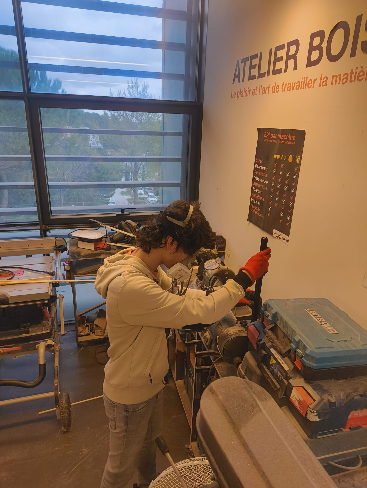

Nous avons reçu les barres d'aluminium profilé. J'ai donc commencé par vérifier les cotes de coupe avant de passer à la découpe.

Le disque de la scie à onglet radiale étant usé, j'ai dû découper les 15 profilés à la scie à métaux, serrés dans l'étau. Cette étape a été longue, surtout au début, à cause de la lame usée et d'une technique inadaptée. Après avoir changé la lame et appliqué les conseils reçus sur l'utilisation de la scie à métaux, la découpe est devenue plus efficace.

Une fois la découpe terminée, j'ai repris chaque extrémité à la ponceuse à bande pour éliminer les bavures et redresser la coupe. Cette étape a été réalisée avec les équipements de protection adaptés : gants, lunettes de protection et masque anti-poussière.

En fin de séance, j'ai nettoyé et passé l'aspirateur sur mon poste de travail dans l'atelier.

Cette séance a été entièrement consacrée à la découpe et à la préparation des profilés.

